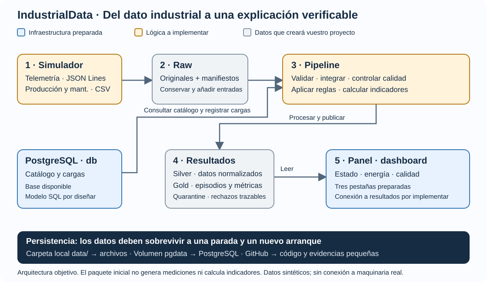
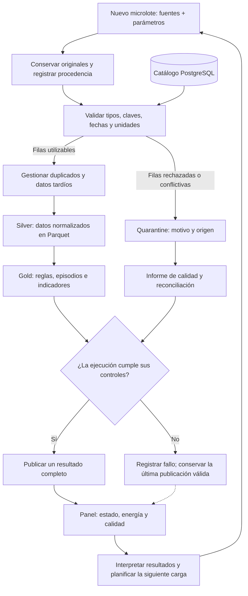

# IndustrialData · Paquete inicial del alumnado

**UT1 · Sistemas de Big Data · RA1**  
I.E.S. Ataulfo Argenta · Castro Urdiales · Especialización en Inteligencia Artificial y Big Data · 2026–2027

Vuestro equipo construirá una plataforma de datos para una planta industrial ficticia del entorno de Castro Urdiales y Bizkaia. Integraréis mediciones de máquinas, producción, mantenimiento y un catálogo para explicar incidencias, calidad de datos y consumo energético.

**Este repositorio es un punto de partida, no una práctica resuelta.** Los datos serán sintéticos; no representan una empresa real. El [enunciado completo y la rúbrica](docs/enunciado.html) definen los requisitos. Este README acompaña el arranque y deberá evolucionar hasta explicar vuestro proyecto terminado.

## 1. Qué recibís y qué construiréis

| Incluido y utilizable desde el inicio | Trabajo que debe realizar el equipo |
|---|---|
| Docker Compose, red y volumen PostgreSQL | Modelo SQL, catálogo, ventanas y registro de cargas |
| Imagen Python con bibliotecas fijadas | Generador reproducible y escenarios S01–S08 |
| Interfaces de los comandos del simulador y pipeline | Ingesta, validación, conflictos, lotes tardíos y trazabilidad |
| Panel vacío con tres pestañas | Indicadores, reglas, episodios, filtros y evidencias |
| Tres pruebas de infraestructura | Pruebas de aceptación P01–P11 con casos propios |
| Plantillas de notebooks, documentación e issues | Experimentos ejecutados, decisiones, informe y defensa |
| Perfil opcional de Spark local y prueba de arranque | Comparación equivalente pandas/PySpark |

No se incluyen un modelo de dominio resuelto, datos generados, detectores, resultados esperados privados, notebooks resueltos ni mediciones de referencia del profesor.

## 2. El proyecto de un vistazo



El dibujo representa el sistema que construiréis. Los servicios arrancan con esta plantilla; su lógica industrial está pendiente. PostgreSQL conserva catálogo y cargas. La carpeta `data/` conserva los archivos. El panel debe leer únicamente resultados publicados correctamente.

### Ciclo de una carga

GitHub representa el siguiente esquema Mermaid. Si vuestro editor no lo dibuja, abrid el repositorio en GitHub; el esquema SVG anterior también puede abrirse directamente en el navegador.



Una fila rechazada y un fallo fatal de ejecución son situaciones diferentes. Documentad qué errores permiten continuar y cuáles impiden publicar. `escenarios_esperados.json` servirá para evaluar vuestro simulador y detector; el detector no debe consultarlo para decidir alertas.

## 3. Primer arranque: unos minutos para comprobar la base

Necesitáis Docker Desktop con **contenedores Linux** y Docker Compose. No hace falta instalar Python ni PostgreSQL en Windows. La primera construcción requiere internet. Git es necesario cuando empecéis a versionar el trabajo; podéis consultar los notebooks en Colab como en UT1.

Como orientación de trabajo, reservad unos 4 GB para la base y más recursos para el millón de observaciones o Spark. El consumo de vuestra implementación deberá medirse; estos valores no son mínimos garantizados. No ejecutéis varios experimentos grandes a la vez.

### Paso 1. Abrir la carpeta correcta

Descomprimid el paquete en una carpeta de trabajo. Abrid una terminal **dentro de `IndustrialData_Alumnado/`, donde están este README y `compose.yaml`**. Todos los comandos siguientes se ejecutan ahí. No trabajéis desde la carpeta general que contiene otros materiales del curso.

En PowerShell:

```powershell
Copy-Item .env.example .env
```

En Linux/macOS:

```bash
cp .env.example .env
```

Los valores son exclusivos de la demo local. Si el puerto 8501 está ocupado, editad `.env` y poned `DASHBOARD_PORT=8502`; entonces abriréis `http://localhost:8502`. PostgreSQL no publica un puerto en el equipo anfitrión.

### Paso 2. Construir e iniciar

```console
docker compose config --quiet
docker compose build pipeline
docker compose up -d --wait db dashboard
docker compose run --rm pipeline python scripts/check_infra.py
docker compose run --rm pipeline python -m pytest -q
docker compose ps
```

Simulator, pipeline y dashboard comparten imagen; basta construir `pipeline`. Los servicios `simulator` y `pipeline` son tareas puntuales: no tienen que permanecer encendidos. Aunque están en el perfil `tools`, se pueden ejecutar directamente por su nombre.

### Paso 3. Comprobar lo que debe ocurrir

- `db` y `dashboard` aparecen saludables (`healthy`).
- `check_infra.py` muestra `infrastructure: OK`; crea las carpetas de trabajo vacías y comprueba la conexión SQL.
- Pytest muestra **3 pruebas superadas y 11 omitidas**. Las tres comprueban infraestructura; las once son tareas P01–P11 todavía sin implementar. **No significa que la práctica esté aprobada ni terminada.**
- Abrís [el panel local](http://localhost:8501) y veis tres pestañas y un aviso de que no hay resultados conectados.
- La base de datos está disponible, pero aún no contiene vuestro catálogo ni un modelo industrial.

El arranque inicial no genera mediciones ni indicadores inventados. Empezad por H1: diseño y planificación.

## 4. Del punto de partida al proyecto funcionando

### H1–H2: diseñar, modelar y simular

Completad `docs/modelo_y_contrato.md`, diseñad SQL en `sql/` e implementad `src/industrialdata/generate.py`. Después, estos comandos deberán generar fuentes y escenarios:

```console
docker compose run --rm simulator python -m industrialdata.generate --help
docker compose run --rm simulator python -m industrialdata.generate --seed 42 --scenario demo --machines 6 --minutes 1440
```

**En la plantilla, `--help` funciona y la generación termina con código 2 y el mensaje «H2 pendiente».** Es intencionado. Sustituid `NotImplementedError` por vuestro desarrollo; no lo cambiéis por un éxito vacío. El contrato inicial propone `--output /data/raw`; ampliad y documentad la interfaz si vuestro diseño lo necesita.

### H3–H4: procesar y presentar

Implementad la carga ordinaria en `run.py` y los módulos auxiliares. Después podréis ejecutar:

```console
docker compose run --rm pipeline python -m industrialdata.run --input /data/raw
```

**En la plantilla también termina con código 2**, porque el procesamiento aún no existe. El panel es una estructura vacía: debéis conectar sus vistas a vuestra estrategia de publicación y mostrar periodo, unidades, calidad y última ejecución correcta.

El trabajo ordinario debe funcionar sin abrir notebooks. Conservad los originales, documentad la política de conflictos y probad repetición y llegada tardía antes de aumentar el volumen.

### H5: pruebas, formatos y motores

```console
docker compose run --rm pipeline python -m pytest -q -m infra
docker compose run --rm pipeline python -m pytest -q -m aceptacion -rs
```

Reemplazad los casos omitidos de `tests/test_acceptance_pending.py` por pruebas ejecutables con datos pequeños y resultados independientes. A medida que avancéis, el número de omisiones debe disminuir. No eliminéis requisitos para hacer que la salida parezca correcta.

Las plantillas de `notebooks/` contienen preguntas y celdas vacías, no soluciones. Incluid finalmente un notebook ejecutado y las versiones. La comparación obligatoria con Spark puede hacerse en Colab; el contenedor siguiente es una alternativa local opcional:

```console
docker compose --profile spark build spark
docker compose --profile spark run --rm spark
```

Esta orden solo verifica que Spark puede arrancar y contar tres filas de prueba. **No compara datos industriales con Pandas.** Usa Java 17, PySpark 4.0.3 y `local[2]`, con un límite de 3 GB y 2 CPU en Compose. Adaptad recursos y scripts al experimento y registrad cualquier cambio. No representa un clúster distribuido. No se incluye un servidor Jupyter: podéis abrir los notebooks con Colab o vuestro editor habitual.

## 5. Mapa del repositorio

```text
IndustrialData_Alumnado/
├── README.md                  # Guía viva: completadla con vuestro proyecto
├── compose.yaml               # Servicios y persistencia
├── .env.example               # Configuración local de ejemplo
├── requirements.txt           # Dependencias de la imagen Python
├── pyproject.toml             # Paquete Python y configuración de pytest
├── .github/                   # Formularios de tareas y plantilla de PR
├── CONTRIBUTING.md            # Acuerdos de colaboración
├── docker/                    # Imagen común e imagen opcional Spark
├── sql/                       # Inicialización; modelo pendiente
├── src/industrialdata/        # Interfaces y módulos por desarrollar
├── dashboard/                 # Tres pestañas vacías
├── notebooks/                 # Plantillas de experimentos
├── tests/                     # Infraestructura + agenda P01–P11
├── sample_data/               # Añadid vuestra muestra pequeña reproducible
├── schemas/                   # Añadid contratos y esquema Avro
├── scripts/                   # Comprobaciones de arranque
├── docs/                      # Enunciado, diagramas y documentos por completar
├── reports/                   # Añadid evidencias pequeñas de vuestro trabajo
└── data/                      # Archivos generados; excluidos de Git
```

## 6. Qué se conserva y cómo se actualiza

| Elemento | Dónde vive | Qué debéis saber |
|---|---|---|
| Catálogo, ventanas y cargas | Volumen Docker `pgdata` del proyecto | Persiste al detener servicios y con `docker compose down` sin `-v` |
| Raw, silver, gold, quarantine e informes generados | Carpeta local `data/`, montada en `/data` | No se sube a Git; conservad la carpeta cuando mováis el proyecto |
| Código y pruebas | Carpetas del repositorio, montadas como solo lectura dentro de los contenedores | Editad en el equipo; una nueva ejecución ve el cambio |
| Panel | `dashboard/`, montado en solo lectura | Streamlit puede recargar cambios; si es necesario, reiniciad el servicio |
| Dependencias y sistema base | Imágenes Docker | Si cambian `requirements.txt` o Dockerfiles, reconstruid la imagen |

La red `backend` conecta servicios por nombre; desde un contenedor, PostgreSQL está en `db:5432`, no en `localhost`. Es una red propia de Compose; no se bloquea la salida a internet. Solo el panel publica un puerto, limitado a la interfaz local del equipo.

Los archivos SQL de `sql/` se ejecutan **solo al crear un volumen PostgreSQL vacío**. Cambiar `001_inicio.sql` no actualiza un volumen existente. Documentad migraciones y aplicadlas explícitamente; por ejemplo, cuando hayáis creado vuestro archivo:

```console
docker compose exec db sh -c 'psql -v ON_ERROR_STOP=1 -U "$POSTGRES_USER" -d "$POSTGRES_DB" -f /docker-entrypoint-initdb.d/002_modelo.sql'
```

`002_modelo.sql` es un nombre de ejemplo: **no se incluye un modelo resuelto**. No borréis volúmenes para simular idempotencia o aplicar cambios. Cambiar la contraseña en `.env` tampoco cambia la de un usuario ya creado dentro del volumen; requiere una operación SQL deliberada.

Para parar y continuar:

```console
docker compose stop
docker compose up -d --wait db dashboard
```

Para retirar contenedores y red conservando datos:

```console
docker compose down
```

No añadáis `-v` si queréis conservar PostgreSQL. Para P09, comparad catálogo y resultados antes y después del reinicio sin regenerarlos. Que el panel abra no demuestra por sí solo que los datos sigan intactos.

## 7. Iniciar el trabajo en GitHub

El paquete no crea ni publica ningún repositorio. Desde **esta carpeta**:

```console
git init -b main
git add .
git status
git commit -m "Añadir estructura inicial de IndustrialData"
```

Revisad `git status`: `.env` y los históricos de `data/` no deben entrar en el commit. Cread un repositorio vacío en GitHub y usad su URL real en lugar del marcador siguiente:

```console
git remote add origin https://github.com/TU_USUARIO/industrialdata.git
git push -u origin main
```

Puede ser privado con acceso para el profesor; hacerlo público como portfolio es opcional. No inicialicéis otro README en GitHub si ya habéis creado el commit local.

Usad las plantillas de `.github/` para abrir tareas y revisar cambios. Preparad un tablero **Pendiente → En curso → En revisión → Hecho**, con prioridades y criterios de cierre. Repartid las tres áreas de trabajo, rotad al menos una vez y registrad revisiones reales. Seguid [CONTRIBUTING.md](CONTRIBUTING.md). El paquete no incluye automatización de GitHub Actions: es una ampliación del enunciado.

## 8. Hitos y evidencias del RA1

| Hito | Horas orientativas | Evidencia de cierre | Criterios especialmente relacionados |
|---|---:|---|---|
| H1 Diseño | 4 | Modelo, contrato, preguntas, tablero y decisiones | a, d, e |
| H2 Infraestructura y simulación | 7 | Catálogo y fuentes reproducibles; escenarios propios | b, c, f |
| H3 Ingesta y calidad | 8 | Trazabilidad, reconciliación, Parquet y cuarentena | b, c, d, g |
| H4 Análisis y panel | 7 | Reglas probadas, indicadores y tres vistas | a, b, d, g |
| H5 Rendimiento y verificación | 6 | P01–P11, perfiles, formatos, motores y estimaciones | a, c, f, g |
| H6 Entrega y defensa | 4 | Clon limpio, informe, vídeo y aportaciones | e y defensa individual de todos |

Total: 36 horas orientativas. Esta tabla ayuda a planificar; los pesos y descriptores de evaluación son los del enunciado. Completad [el plan](docs/plan_trabajo.md), [el modelo](docs/modelo_y_contrato.md), [las decisiones](docs/decisiones.md), [las pruebas y mediciones](docs/pruebas_y_mediciones.md) y [el informe](docs/informe_plantilla.md).

## 9. Si algo no arranca

| Síntoma | Comprobación o acción |
|---|---|
| No se puede conectar con Docker | Iniciad Docker Desktop y esperad al motor Linux; `docker version` debe mostrar cliente y servidor |
| Puerto ocupado | Cambiad `DASHBOARD_PORT` en `.env`; recread con `docker compose up -d --wait dashboard` |
| PostgreSQL no está saludable | Consultad `docker compose logs db`; no borréis datos para ocultar el fallo |
| Generador o pipeline devuelve código 2 | Es el estado inicial intencionado: falta implementar los hitos indicados |
| 11 pruebas omitidas | Es la agenda de aceptación pendiente, no once pruebas superadas |
| No cambian las tablas al editar SQL | El volumen ya existía; aplicad la migración explícita |
| Cambié una biblioteca y no aparece | Ejecutad `docker compose build pipeline` y recread el dashboard |
| Spark se queda sin memoria | Revisad sus límites y el tamaño de prueba; justificad los recursos o usad Colab |

Comandos útiles:

```console
docker compose logs --tail 100 db dashboard
docker compose run --rm pipeline python -m pip freeze
docker compose exec db sh -c 'psql -U "$POSTGRES_USER" -d "$POSTGRES_DB"'
```

## 10. Antes de entregar

- Sustituid las instrucciones de plantilla por las de vuestro sistema real, manteniendo lo que siga siendo útil.
- Comprobad desde un clon limpio el flujo completo, no solo la infraestructura.
- Incluid una muestra pequeña, escenarios propios, contratos y pruebas independientes.
- Registrad versiones, resultados, limitaciones y problemas pendientes sin inventar mediciones.
- Añadid capturas, informe de 6–10 páginas, vídeo de 3–5 minutos y aportaciones trazables.
- Citad fuentes y declarad las ayudas utilizadas, incluida IA, explicando qué habéis comprobado.
- Entregad URL, commit o etiqueta `v1.0` e informe según Moodle.

Fuentes de consulta: [Docker Compose](https://docs.docker.com/compose/how-tos/startup-order/), [PostgreSQL 16](https://www.postgresql.org/docs/16/), [Streamlit](https://docs.streamlit.io/), [Spark 4.0.3](https://spark.apache.org/docs/4.0.3/) y los materiales de UT1. Las versiones de esta base están fijadas; registrad y justificad cualquier actualización.
